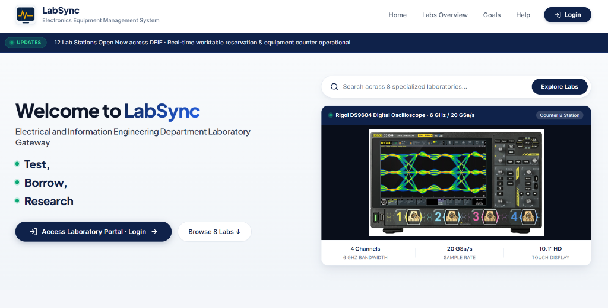

# LabSync - Electronics Equipment and Laboratory Management System

LabSync is a web application designed for the Department of Electrical and Information Engineering (DEIE) at the Faculty of Engineering, University of Ruhuna. It manages electronic laboratory equipment, tracks component inventory, allocates practical session kits, and handles student borrowing and return workflows.



## Prerequisites

- Node.js (v18.x or higher)
- npm (bundled with Node.js)
- Git
- MongoDB (Choose either option):
  - **Option A (Recommended for local evaluation):** Local MongoDB Community Edition running on `mongodb://127.0.0.1:27017/electro-lab` (No account needed)
  - **Option B:** Free MongoDB Atlas cloud cluster

## Setup Instructions

### 1. Clone the Repository

Open a terminal or PowerShell in your desired directory and run:

```powershell
git clone https://github.com/IranGunarathna/electro-lab-manager.git
cd electro-lab-manager
```

### 2. Configure Backend

Navigate to the `backend` folder and install dependencies:

```powershell
cd backend
npm install
```

Create your `.env` file by copying `.env.example`:

**On Windows (PowerShell):**
```powershell
Copy-Item .env.example .env
```

**On Linux / macOS:**
```bash
cp .env.example .env
```

Open `.env` in a text editor and configure your database connection:

```env
PORT=5000

# For Local MongoDB (Default):
MONGO_URI=mongodb://127.0.0.1:27017/electro-lab

# Or for MongoDB Atlas:
# MONGO_URI=mongodb+srv://<username>:<password>@cluster.mongodb.net/electro-lab?retryWrites=true&w=majority

JWT_SECRET=super_secret_electro_lab_key_123
```

*(Note: If you are using local MongoDB running on port 27017, the application will automatically connect to `mongodb://127.0.0.1:27017/electro-lab` even without setting `MONGO_URI`.)*

### 3. Seed Database

Populate your database with the default admin accounts, student accounts, laboratory components, and practical session data:

```powershell
# Seed administrator and lab assistant accounts
npm run seed:users

# Seed electronic components inventory
npm run seed:components

# Seed student accounts (Semester 3 and 4)
node seedStudents.js

# Seed practical sessions and equipment kits
node seedPracticalsAndComponents.js
```

**Alternative:** Seed users and components together:

```powershell
npm run seed:all
```

### 4. Configure Frontend

Open a new terminal window or navigate back to the root directory, then move into the `frontend` directory:

```powershell
cd ..\frontend
npm install
```

## Running the Application

### 1. Start the Backend Server

From the `backend` directory, run:

```powershell
npm run dev
```

The backend server will start on `http://localhost:5000`. You can verify it is working by opening `http://localhost:5000/api/health` in your browser.

### 2. Start the Frontend Development Server

From the `frontend` directory, run:

```powershell
npm run dev
```

The Vite development server will start on `http://localhost:5173`.

### 3. Access the Application

Open your browser and navigate to:

```text
http://localhost:5173
```

## Default Login Credentials

After running the database seeders, you can log in using any of the following accounts:

| Role | Username / Uni Email | Password | Access Level |
|---|---|---|---|
| Admin | `admin@eng.ruh.ac.lk` (or `ADM001`) | `password123` | Full administrative control, user management, inventory settings |
| Lab Assistant | `officer@eng.ruh.ac.lk` (or `LAB001`) | `password123` | Equipment approval, component check-in/out, damage logging |
| Student (Semester 3) | `eg20235456@eng.ruh.ac.lk` (or `EG/2023/5456`) | `password123` | Browse catalog, request loans, view practical kits |
| Student (Semester 4) | `eg20235485@eng.ruh.ac.lk` (or `EG/2023/5485`) | `password123` | Browse catalog, request loans, view practical kits |

## Project Files

### Backend (`/backend`)
- `server.js` - Main backend server entry point and API route definitions
- `config/db.js` - MongoDB connection handler using Mongoose
- `controllers/` - Route controller logic for authentication, components, loans, and practical sessions
- `models/` - Mongoose data schemas (User, Component, Borrow, LabSession, Equipment, Transaction)
- `routes/` - Express endpoint route declarations
- `middleware/` - JWT authentication and authorization middlewares
- `seeder.js` - Seeder script for Admin and Lab Assistant accounts
- `seedComponents.js` - Seeder script for electronic components and laboratory equipment
- `seedStudents.js` - Seeder script for student profiles
- `seedPracticalsAndComponents.js` - Seeder script for practical session kits
- `.env.example` - Template for backend environment variables

### Frontend (`/frontend`)
- `src/App.jsx` - Root routing setup (Landing, Login, Protected Dashboard)
- `src/pages/Landing.jsx` - Public laboratory discovery portal and equipment search
- `src/pages/Login.jsx` - User authentication page
- `src/pages/Dashboard.jsx` - Role-based dashboard (Admin, Lab Assistant, Student views)
- `src/components/ProtectedRoute.jsx` - Route protection guard checking JWT authentication
- `src/api/axios.js` - Axios instance with auto-injected JWT authorization header
- `vite.config.js` - Vite configuration file

### Assets (`/assets`)
- `labsync-preview.png` - Application preview screenshot for documentation

## Features

- Lab station tracker across 8 specialized DEIE laboratories
- Searchable electronic component and equipment catalog
- Role-based access control for Admins, Lab Assistants, and Students
- Component loan request, approval, and return tracking
- Practical session kit allocation mapped to academic semesters
- JWT-based authentication with bcrypt password hashing
- Responsive UI built with React 19 and modern CSS

## Troubleshooting

### MongoDB connection error
- If using MongoDB Atlas, check your network whitelist under **Network Access** in Atlas (`0.0.0.0/0` allows all IPs for development).
- Check that your username, password, and database connection string in `backend/.env` are correct.
- If using a local MongoDB instance, ensure the `mongod` service is running.

### Port already in use (5000 or 5173)
- Check which process is using the port:
  ```powershell
  netstat -ano | findstr :5000
  ```
- Terminate the process by ID:
  ```powershell
  taskkill /PID <PID> /F
  ```
- Alternatively, change the port in `backend/.env` and update the base URL in `frontend/src/api/axios.js`.

### Frontend cannot reach backend
- Ensure the backend server is running in another terminal.
- Verify that `frontend/src/api/axios.js` is set to `http://localhost:5000/api`.

### Missing dependencies or build errors
- Delete `node_modules` and re-install:
  ```powershell
  # Backend
  cd backend
  Remove-Item -Recurse -Force node_modules, package-lock.json
  npm install

  # Frontend
  cd ..\frontend
  Remove-Item -Recurse -Force node_modules, package-lock.json
  npm install
  ```
